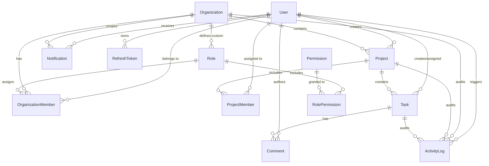

# Database Architecture Documentation — Phase 2

## 1. Overview

The Multi-Tenant SaaS Project Management Platform uses **PostgreSQL 16** managed via **Prisma ORM (v5.22.0)**. The database architecture is designed to support strict tenant isolation, role-based access control, real-time collaboration, audit logging, and scalable performance.

---

## 2. Entity Overview (13 Models)

1. **`User`**: Account model storing user credentials, full names, avatar URLs, and active status.
2. **`Organization`**: Primary tenant boundary representing an enterprise or organization workspace.
3. **`OrganizationMember`**: Junction model mapping Users to Organizations with assigned system/tenant Roles.
4. **`Role`**: Access control role definitions. Can be global system roles (`organizationId = null`) or tenant-custom roles (`organizationId` set).
5. **`Permission`**: Granular system permissions (e.g. `organization:read`, `project:create`, `task:update`).
6. **`RolePermission`**: Junction table mapping Roles to Permissions.
7. **`Project`**: Workspaces belonging to an Organization for grouping tasks and team members.
8. **`ProjectMember`**: Direct membership mapping Users to specific Projects.
9. **`Task`**: Work items within a Project with status (`TODO`, `IN_PROGRESS`, `IN_REVIEW`, `DONE`), priority (`LOW`, `MEDIUM`, `HIGH`, `URGENT`), assigned user, and due date.
10. **`Comment`**: Discussion entries on Tasks created by Users.
11. **`ActivityLog`**: Audit trail records storing action strings and flexible JSON metadata per tenant organization.
12. **`Notification`**: In-app notifications per user and tenant, with read/unread state tracking.
13. **`RefreshToken`**: Hashed OAuth/JWT refresh tokens supporting multi-device session revocation.

---

## 3. Entity-Relationship Diagram

---

## 4. Tenant Isolation Strategy

Multi-tenancy isolation is structured around the `Organization` entity:
- **Direct Tenant Ownership**: `OrganizationMember`, `Role`, `Project`, `ActivityLog`, and `Notification` contain an `organizationId` foreign key referencing `Organization.id`.
- **Traceable Tenant Ownership**: `Task`, `Comment`, and `ProjectMember` link deterministically to `Organization` through their parent `Project` or `Task` relationship.
- **Enforcement Layer**: NestJS application-level guards and service filters will enforce tenant context (`organizationId`) in subsequent phases.

---

## 5. Indexing Strategy

Indexes are explicitly applied to primary lookup vectors and foreign keys to prevent full-table scans:

| Table | Indexed Columns | Rationale |
|---|---|---|
| `User` | `email` | Fast authentication lookups |
| `Organization` | `slug` | Tenant workspace URL resolution (`/org/:slug`) |
| `OrganizationMember` | `organizationId`, `userId`, `(organizationId, userId)` | Member listing and membership check |
| `Role` | `organizationId` | Fetching system vs org-specific custom roles |
| `Permission` | `name` | Permission resolution lookups |
| `RolePermission` | `roleId`, `permissionId`, `(roleId, permissionId)` | Role-to-permission mapping lookups |
| `Project` | `organizationId` | Filtering projects by tenant organization |
| `ProjectMember` | `projectId`, `userId`, `(projectId, userId)` | Project membership validation |
| `Task` | `projectId`, `assignedToId`, `status`, `priority`, `dueDate` | Kanban filters, assignees, and due-date queries |
| `Comment` | `taskId` | Loading task conversation threads |
| `ActivityLog` | `organizationId`, `userId`, `createdAt` | Tenant audit timeline sorting and filtering |
| `Notification` | `userId`, `organizationId`, `isRead` | Unread notifications badge counter |
| `RefreshToken` | `userId`, `expiresAt` | Token validation and expired session purging |

---

## 6. Foreign Key Cascades & Data Integrity

- **Cascade Delete (`onDelete: Cascade`)**:
  - Deleting an `Organization` automatically cascades deletion of its `OrganizationMember`, `Role` (custom), `Project`, `ActivityLog`, and `Notification` records.
  - Deleting a `Project` cascades `ProjectMember` and `Task` records.
  - Deleting a `Task` cascades `Comment` records.
- **Set Null (`onDelete: SetNull`)**:
  - Deleting a `User` sets `createdById` and `assignedToId` on `Task` and `Project` to `NULL`, preserving audit history without breaking foreign key constraints.
- **Restrict (`onDelete: Restrict`)**:
  - Deleting a `Role` is restricted if active `OrganizationMember` records depend on it.

---

## 7. Migration & Seeding Strategy

- **Migration Command**: `npx prisma migrate dev --name <migration_name>` generates declarative SQL scripts under `backend/prisma/migrations/`.
- **Seeding Command**: `npx prisma db seed` runs `backend/prisma/seed.ts` using `ts-node`.
- **Seed Data**:
  - **1 Tenant Organization**: `Acme Corporation` (`acme-corp`)
  - **15 Granular Permissions**
  - **3 System Roles**: `OWNER`, `ADMIN`, `MEMBER`
  - **3 Users**:
    - Alex Owner (`owner@acme.com`)
    - Sarah Admin (`admin@acme.com`)
    - Mike Developer (`member@acme.com`)
  - **2 Projects**: `Mobile App Redesign`, `API Integration Platform`
  - **Tasks, Comments, Activity Logs, Notifications**
